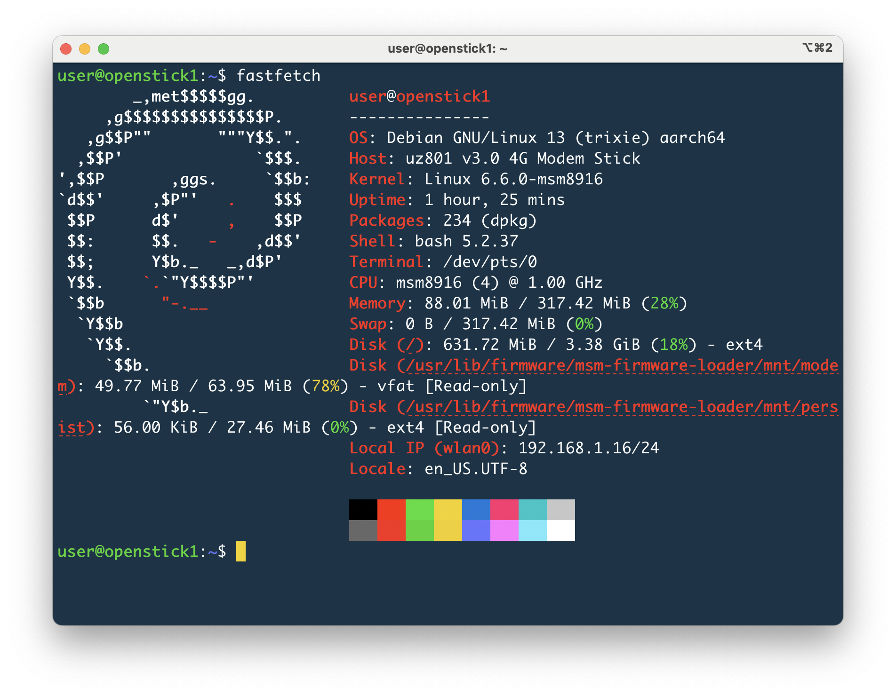

# OpenStick Post-Flash Hardening & Optimization

This guide contains the sequence of commands and configurations required to safely lock down, optimize, and expand an [OpenStick](https://openstick.org/) (Qualcomm LTE USB Dongle) running a Debian-based Linux distribution. 



Once the OpenStick flash is successful, you can either keep your device plugged in via USB or connect to its built-in Wi-Fi network (typically named `Openstick` with password `openstick`) for initial configuration.

You can establish the initial connection using:
* **USB Interface:** `ssh user@192.168.4.1`
* **Wi-Fi Interface:** `ssh user@192.168.5.1`
* **Default Password:** `1`

---

## 1. Network Configuration

By default, the OpenStick broadcasts an unencrypted or weak factory hotspot that locks up the single Wi-Fi chip. If you don't use it as a modem any more, we can identify it, disable it, and connect the stick to your local Wi-Fi.

```bash
# 1. View the network interface states
sudo nmcli device status

# 2. Look for the active hotspot profile under the "CONNECTION" column (usually named "hotspot" or "uoneet")
sudo nmcli connection show

# 3. Shut down the hotspot and disable autoconnect on boot
sudo nmcli connection down hotspot
sudo nmcli connection modify hotspot connection.autoconnect no

# 4. Scan the area for your home Wi-Fi network SSID
sudo nmcli device wifi list

# 5. Connect the stick to your home Wi-Fi network over the air
sudo nmcli dev wifi connect "YOUR_WIFI_NAME" password "YOUR_WIFI_PASSWORD"
```

> ⚠️ **Safety Note:** Avoid disabling or downing the USB network interface (`usb0`). If your Wi-Fi credentials change or fail, the physical USB tether is your only fallback access method. If you lose access entirely, you must press the hardware reset button on the stick while plugging it into your computer, check detection with `fastboot devices`, drop into emergency download mode via `fastboot oem reboot-edl`, and completely re-flash the base OpenStick image.  To avoid that scenario, you may also use the following fallback which enables default hotspot only if the stick cannot connect to your WiFi. 

---

## 2. Automated Wi-Fi Hotspot Fallback (Headless Safety Net)

If your home Wi-Fi credentials change, or if you take your OpenStick travelling, it will lose connectivity. This configuration sets up a native `systemd` background service that monitors the network on boot. If the stick fails to connect to your home Wi-Fi within 45 seconds, it automatically spins up your custom emergency hotspot so you never get locked out.

### 1. Create the Fallback Execution Script
```bash
sudo nano /usr/local/bin/wifi-fallback.sh
```

**Paste the following inside the file (replace `YOUR_HOME_WIFI_NAME` with your actual Wi-Fi SSID):**
```bash
#!/bin/bash
# Allow the stick up to 45 seconds to attempt latching onto home Wi-Fi
sleep 45

# Check if wlan0 has a valid IP address
if ! ip addr show wlan0 | grep -q "inet "; then
    echo "Home Wi-Fi not found or failed. Activating emergency hotspot..."
    # Take down the active home Wi-Fi profile attempts
    sudo nmcli connection down "YOUR_HOME_WIFI_NAME"
    # Instantly fire up the backup hotspot
    sudo nmcli connection up hotspot
else
    echo "Home Wi-Fi connected successfully. Hotspot fallback skipped."
fi
```
*Press `Ctrl + O` then `Enter` to save, and `Ctrl + X` to exit.*

```bash
# Make the file executable so the system can execute it
sudo chmod +x /usr/local/bin/wifi-fallback.sh
```

### 2. Create the systemd Service Descriptor
```bash
sudo nano /etc/systemd/system/wifi-fallback.service
```

**Paste the following configuration exactly as shown:**
```text
[Unit]
Description=Emergency Wi-Fi Hotspot Fallback Service
After=network-online.target NetworkManager.service
Wants=network-online.target

[Service]
Type=simple
ExecStart=/usr/local/bin/wifi-fallback.sh
RemainAfterExit=yes

[Install]
WantedBy=multi-user.target
```
*Press `Ctrl + O` then `Enter` to save, and `Ctrl + X` to exit.*

### 3. Load, Enable, and Test the Service
```bash
# 1. Force systemd to scan the disk for the new service file
sudo systemctl daemon-reload

# 2. Instruct the OS to register this service to run automatically on every boot
sudo systemctl enable wifi-fallback.service

# 3. Test run the service manually to verify there are no syntax errors
sudo systemctl start wifi-fallback.service
```

### 4. Review Service Status & Maintenance Logs
To audit what the service decided to do during boot (whether it skipped or triggered the AP fallback), view its logs:
```bash
sudo journalctl -u wifi-fallback.service
```


---

## 3. Package Updates & Essential Tooling

Ensure the system package databases are updated, core security patches are applied, and core utilities are installed.

```bash
# 1. Synchronize repositories and upgrade all running packages
sudo apt update && sudo apt -y upgrade

# 2. Configure the proper system timezone interactively
sudo dpkg-reconfigure tzdata

# 3. Install diagnostic, text editing, swap management, and mDNS tools
sudo apt install -y fastfetch nano zram-tools avahi-daemon
```

---

## 4. Flash Storage Protection (Log Minimization)

To prevent the internal eMMC flash chip from wearing out due to constant system write actions, force system logs to reside strictly inside volatile RAM.

```bash
# 1. Open the systemd logging daemon configuration file
sudo nano /etc/systemd/journald.conf
```

**Inside `/etc/systemd/journald.conf`, uncomment or append the following specific values under the `[Journal]` block:**
```text
[Journal]
Storage=volatile
RuntimeMaxUse=32M
```
*Press `Ctrl + O` then `Enter` to save, and `Ctrl + X` to exit.*

```bash
# 2. Restart the logging manager daemon to activate the rules
sudo systemctl restart systemd-journald
```

---

## 5. Credential Lockdowns & Hostname Mapping

Eliminate the weak default credentials (`user` / `1`) and establish a custom hostname so the stick can be targeted locally via `.local` naming.

```bash
# 1. Change the password for the standard 'user' account
passwd

# 2. Change the password for the root administrative user
sudo passwd root

# 3. Explicitly verify the account is mapped to the sudo group
sudo usermod -aG sudo user

# 4. Review or edit sudo privilege rules if you want to enforce password challenges ( by removing NOPASSWD: to the output of command below so it should look like user ALL=(ALL:ALL) ALL )

sudo visudo /etc/sudoers.d/user

# 5. Assign the new local hostname network identity (e.g., openstick0)
sudo hostnamectl set-hostname openstick0

# 6. Map the local system resolution loops to point to the new hostname
sudo nano /etc/hosts
```
**Inside `/etc/hosts`, update the local routing entry line to look exactly like this:**
```text
127.0.1.1       openstick0
```
*Press `Ctrl + O` then `Enter` to save, and `Ctrl + X` to exit.*

```bash
# 7. Enable and start the network name broadcaster immediately to activate mDNS
sudo systemctl enable --now avahi-daemon
```

---

## 6. SSH Host Cryptographic Key Regeneration

Because standard factory images ship with identical default SSH host identification profiles, purge them entirely so your stick generates unique security hashes.

```bash
# 1. Completely remove the generic factory-cloned public/private host keys
sudo rm /etc/ssh/ssh_host_*

# 2. Force the OpenSSH server installation wizard to generate brand new ones
sudo dpkg-reconfigure openssh-server

# 3. Reload the SSH service daemon
sudo systemctl restart ssh
```

---

## 7. Memory Space Compression Engine (Zram Setup)

Configure the system compressed swap container to take up 100% of the total RAM footprint, accelerating system throughput without degrading the eMMC storage.

```bash
# 1. Open the zramswap configuration template
sudo nano /etc/default/zramswap
```
**Navigate to the bottom of `/etc/default/zramswap` and ensure these values are written (ensure any line starting with `SIZE=` is commented out with a `#`):**
```text
ALGO=lz4
PERCENT=100
PRIORITY=100
```
*Press `Ctrl + O` then `Enter` to save, and `Ctrl + X` to exit.*

```bash
# 2. Restart the compressed memory manager system daemon
sudo systemctl restart zramswap

# 3. Verify that /dev/zram0 matches 100% of your total device RAM
free -h
sudo swapon --show
```

---

## 8. Storage Maps Alignment & Partition Expansion

Correct the raw image flashing layout boundaries by realigning the partition map tracking headers to clear out the GPT PMBR size mismatch warning.

```bash
# 1. Check current disk layouts and scan for errors
sudo fdisk -l /dev/mmcblk0
```

If you receive the warning: `GPT PMBR size mismatch (XXXXX != XXXXX) will be corrected by write.`, run the following commands to repair it:

```bash
# 2. Open the disk utility map
sudo fdisk /dev/mmcblk0
```
**Inside the interactive `fdisk` prompt:**
* Type **`w`** and press **`Enter`** to automatically relocate the backup GPT table to the physical end of the chip, save adjustments, and exit.

```bash
# 3. Expand the underlying root filesystem to utilize the newly cleared space
# (Verify your root data partition identifier number first using fdisk -l; it is typically the largest partition, such as p14 or p20)
sudo resize2fs /dev/mmcblk0p14
```

---

## 9. Final System Maintenance & Remote Headless Launch

Clean up installation cache leftovers to reclaim valuable eMMC space, then drop power cleanly so the device can run autonomously from a USB power brick.

```bash
# 1. Purge downloaded package archives and remove obsolete package dependencies
sudo apt clean && sudo apt autoremove -y

# 2. Initiate a safe, immediate system power down
sudo poweroff
```

### Unplug the stick and move it to a 5V phone wall charger.

**From your Local Client Terminal (Before Reconnecting over Wi-Fi):**
Because you regenerated unique SSH host keys and altered the identity map, your terminal device will initially reject the connection. Run these lines to clear the old host cache records, then connect seamlessly over the air:

```bash
# On your local computer's terminal:
ssh-keygen -R openstick0.local
ssh user@openstick0.local
```

You can now install lightweight utilities like [Pi-hole](https://pi-hole.net/) or [tailscale](https://tailscale.com/). 

